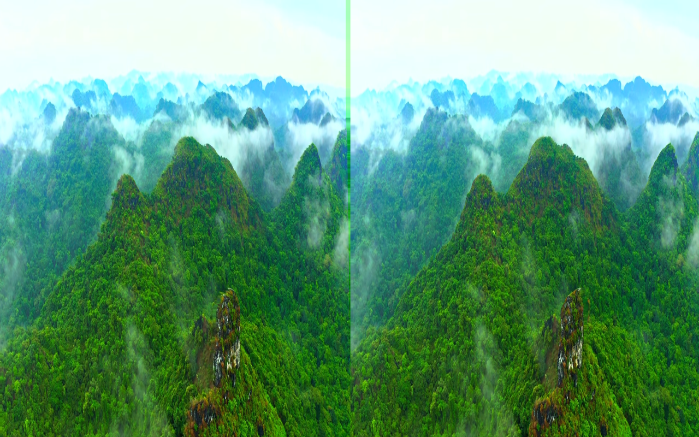

# 2D-3D Video Converter

A Chrome/Brave extension that converts any HTML5 video (YouTube and most other sites) to
**3D in real time** for 3D TVs, monitors and red/cyan glasses. Depth runs locally on your GPU;
nothing leaves your machine ([privacy policy](PRIVACY.md)). DRM-protected video (Netflix,
Disney+, Prime) can't be converted.



## Use

1. Hover a video and click **2D-3D: Off**, or press **Alt+Shift+D**. **Alt+Shift+M** cycles view modes.
2. Go fullscreen with the site's button; 3D stays on.
3. Set the TV's 3D mode to match. If depth looks inside-out, tick **Swap eyes**.

**View modes:** half side-by-side, top-over-bottom, anaglyph, depth map, 2D + depth map.
Captions are redrawn in 3D inside each eye.

**Depth:** ML via WebGPU (Depth Anything V2 Small by default, V3 Small, MiDaS v2.1 Small;
50–105 MB each, downloaded from Hugging Face on first use and cached), or shaders that run on any
GPU (Heuristic, Scene Cues, Ground Plane, Motion Parallax). **Auto** starts with heuristic depth
and switches to Depth Anything V2 if the GPU keeps it under 150 ms per frame.

The popup holds strength, convergence, smoothing, interpolation, ML resolution, freeze on pause,
artifact cleanup and stats. With the Moutheyes or Video Filters extension on, 3D uses their output.

**Dual-GPU systems:** if ML depth is slow, set the browser to **High performance** in Windows
Settings → System → Display → Graphics.

## Build

```sh
npm install
npm run build       # unpacked extension in dist/; load it in chrome://extensions (Developer mode)
npm run watch       # rebuild on change
npm run typecheck
npm run package     # store zip (see STORE.md)
npm run fetch-test-media && npm run e2e -- --headful [--high-perf] [--bench]
```

e2e needs Brave or Chrome for Testing. Code: `src/content/` (video discovery, overlay, sessions),
`src/render/` (WebGL2 stereo renderer), `src/depth/` (models in an extension iframe so page CSPs
can't block WASM/WebGPU).
